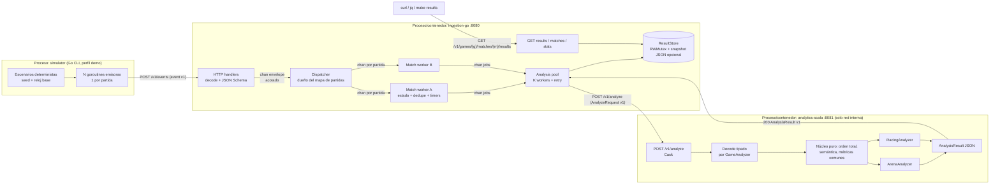
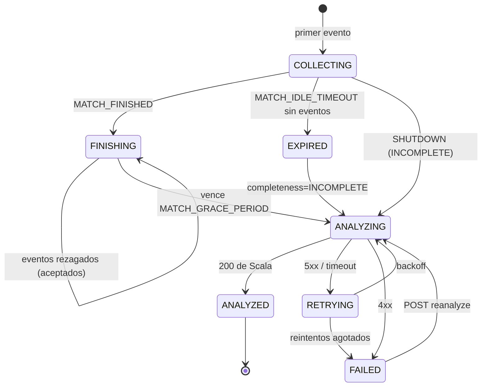

# GameStats — Plan maestro de construcción (Go imperativo + Scala funcional)

> **Contexto.** Proyecto del curso Lenguajes de Programación. El repositorio actual solo contiene `GameStats_Claude_Plan_Contexto.md` (sin código, sin git). Este plan es la guía completa para construir, probar, desplegar y defender GameStats: una plataforma donde un **simulador externo** envía eventos JSON de videojuegos, **Go** los ingiere/valida/agrupa/coordina de forma concurrente y **Scala** calcula estadísticas y detecta patrones de forma funcional, con resultados consultables por HTTP.
>
> **Etiquetas:** `[OBLIGATORIO]` = exigido por el enunciado · `[PROPUESTA]` = decisión del equipo (no impuesta) · `[OPCIONAL]` = solo si sobra tiempo · `[RIESGO]` · `[PENDIENTE DE CONFIRMAR]` = consultar al docente.
>
> **Supuestos explícitos (no bloqueantes):** equipo de 2 personas (si es 1, las tareas "paralelizables" se secuencian); sin presupuesto cloud garantizado; el docente acepta una VM pública con Docker Compose como deployment; el simulador puede escribirse en cualquier lenguaje; el plazo está **[PENDIENTE DE CONFIRMAR]** (el enunciado dice "domingo 18 de setiembre de 2026", pero el 18/09/2026 fue viernes y ya pasó — no se fija fecha nueva).

---

## A. Lectura del problema y matriz de cumplimiento

### A.1 Alcance

**Dentro del alcance [OBLIGATORIO]:** simulador de eventos variado (varias partidas, jugadores, juegos en paralelo, casos especiales); servicio Go de ingestión (recepción, validación estructural, rechazo de inválidos, organización por juego/partida, estado temporal, concurrencia real, envío a Scala); servicio Scala de análisis (modelos propios, colecciones y operaciones funcionales, estadística por jugador, por partida, combinada, regla secuencial, JSON estructurado); protocolo documentado entre componentes independientes; consulta de resultados; Git incremental, builds reproducibles, Docker por módulo, Compose, CI/CD, deployment funcional; documentación y demo; extensibilidad a nuevos juegos/eventos.

**Fuera del alcance:** videojuegos reales, frontend elaborado, big data, ML, Kafka/Kubernetes, BD distribuidas, autenticación multiusuario. Panel web, BD persistente y cola de mensajes quedan como `[OPCIONAL]` P2.

### A.2 Matriz de cumplimiento (requisito → componente → entregable → prueba → fase)

| # | Requisito (enunciado / AC) | Componente responsable | Entregable verificable | Caso de prueba | Fase |
|---|---|---|---|---|---|
| R1 | §3 / AC-01 Estructura común de evento especificada | `contracts/` | `docs/event-spec.md` + `contracts/schemas/*.json` + ejemplos | Go `TestContractExamples` valida `examples/valid` (todos OK) e `invalid` (todos rechazados con código esperado) | F1 |
| R2 | §5 / AC-02 Identidad inequívoca de juego/partida/evento | Contrato + Go `match.Key{GameID,MatchID}` | Spec de IDs | F02/F03 partidas intercaladas → resultados separados | F1, F4 |
| R3 | §6.1 / AC-03 Validación estructural y tratamiento de inválidos | Go `internal/validation` + `httpapi` | 400 con `errors[]`, `/v1/rejections`, log `slog` | F04 (sin `eventId`, timestamp inválido, tipo desconocido, `data` incorrecto) | F4 |
| R4 | §6.1 / AC-04 Concurrencia con goroutines y channels sin carreras | Go `dispatcher`, `match.Worker`, `analysis.Pool` | Topología documentada en `docs/architecture.md` | `TestConcurrentMatches` con `go test -race`; test de aislamiento (partida A lenta no bloquea B) | F4 |
| R5 | §6.1 / AC-05 Estado temporal por partida y criterio de envío | Go `match` (máquina de estados) | Diagrama de estados + endpoint `/v1/games/{g}/matches/{m}` | Tests de transición: FINISHED+gracia, idle timeout, eventos tardíos | F4 |
| R6 | §6.2 / AC-06 Scala procesa datos preparados con transformaciones funcionales | Scala `core`, `games/*` | Código puro + `docs/statistics.md` | Tests unitarios munit de funciones puras; property test de permutación | F5 |
| R7 | §5 / AC-07 Estadística por jugador | Scala `ArenaAnalyzer.playerStats` | `playerStats[]` en JSON | F01: p1 = 3 eliminaciones, 300 de daño, etc. | F5 |
| R8 | §5 / AC-08 Estadística por partida | Scala `CoreMetrics` + `ArenaAnalyzer.matchStats` | `matchStats` | F01: duración 120 s, 4 eliminaciones, 3 participantes | F5 |
| R9 | §5 / AC-09 Estadística que relaciona tipos de evento distintos | Scala `killEfficiency` (ELIMINATION ÷ ATTACK), `eliminationsPerMinute` | `combined` | F01 + F10 (denominador cero → `null`) | F5 |
| R10 | §5 / AC-10 Regla secuencial verdadera | Scala `KillStreak` (fold con estado) | `patterns[]` | F11 positivo / F12 negativo / F06 desorden | F5 |
| R11 | §9 / AC-11 Consulta de resultados | Go `GET /v1/games/{g}/matches/{m}/results` | Ruta documentada + `make results` | e2e compara contra `expected/*.json` | F2, F7 |
| R12 | §8 / AC-12 Simulación variada y paralela | `simulator/` | Escenarios `demo`, `F01..F17`, semilla fija | Log de simulador + e2e | F6 |
| R13 | §12 / AC-13 Extensibilidad sin reescribir núcleo | Contrato por juego + `GameAnalyzer` + registry | Segundo juego `street-racing` | `git diff --stat` de la fase F8 no toca `core/`, `dispatcher/`, `match/` | F8 |
| R14 | §7 / AC-14 Procesos separados con protocolo documentado | Go ↔ Scala vía HTTP | `docs/protocol.md` + `contracts/schemas/analyze-*.json` | Test de contrato en ambos lados con el mismo JSON | F1, F7 |
| R15 | §10 / AC-15 `docker compose up --build` + demo e2e | Dockerfiles + `docker-compose.yml` | `tests/e2e/e2e.sh` | Job `e2e` en CI | F3, F9 |
| R16 | §10 / AC-16 CI compila, prueba, construye imágenes | `.github/workflows/ci.yml` | Ejecuciones verdes | Badge + captura | F3, F9 |
| R17 | §10 / AC-17 Deployment funcional con evidencia | VM + Compose + GHCR | `docs/deployment.md`, `docs/evidence/` | `curl http://<host>:8080/healthz` + demo remota | F10 |
| R18 | §10–11 / AC-18 Commits incrementales + docs + guion | Todo el repo | Historial git, `docs/demo.md`, `docs/defense.md` | Revisión de `git log` | Todas, F11 |
| R19 | §13 Justificación de paradigmas | Docs | `docs/defense.md` | Ensayo de defensa | F11 |
| R20 | §9 "diez funcionalidades mínimas" | Varios | Tabla en README | **[PENDIENTE DE CONFIRMAR]** cotejar literalmente la lista §9 del enunciado original contra esta matriz (el documento de contexto no la transcribe) | F0 |
| R21 | §14 Equipo ≤ 2, originalidad | Equipo | Autoría en commits | — | F0 |

### A.3 Obligatorio vs decisiones del equipo

- **Obligatorio:** Go imperativo para ingestión/coordinación/concurrencia; Scala funcional para análisis; las 4 clases de análisis; protocolo documentado; Docker, CI/CD, deployment, docs, demo, extensibilidad.
- **Decisión del equipo `[PROPUESTA]`:** qué juegos (arena + carreras), catálogo de eventos, HTTP/REST, almacenamiento en memoria en Go con snapshot JSON opcional, JSON Schema como contrato, Cask+upickle en Scala, simulador en Go, VM + GHCR como deployment.

### A.4 Incertidumbres y conflictos

1. Fecha de entrega inconsistente y pasada → `[PENDIENTE DE CONFIRMAR]`.
2. Qué entorno acepta el docente como "deployment" (VM pública, servidor universitario, túnel) → `[PENDIENTE DE CONFIRMAR]`.
3. Lista literal de "diez funcionalidades mínimas" (§9) → cotejar en F0.
4. Validación mínima del profesor exige `playerId` "cuando corresponda": se resuelve con reglas por tipo (obligatorio en eventos de jugador, prohibido/ausente en eventos globales).
5. El ejemplo de evento propone `type` + `action`: se **simplifica a un único `type`** (ver C.1) — no es requisito textual.

---

## B. Propuesta de solución justificada

### B.1 Un juego a fondo vs núcleo genérico + dos juegos

| Criterio | (i) Un juego a fondo | (ii) Núcleo genérico + 2 juegos desde el inicio | **(iii) Recomendado: núcleo genérico + Arena a fondo + Carreras incremental** |
|---|---|---|---|
| Puntuación académica | Débil en AC-13 (extensibilidad solo "prometida") | Alta | Alta: la extensión se **demuestra** con un diff que no toca el núcleo |
| Esfuerzo | Bajo | Alto desde el día 1 | Medio, escalonado |
| Riesgo | Bajo técnico, alto en rúbrica | Alto (abstracción prematura) | Bajo: abstracciones mínimas nacen del 1er juego y se validan con el 2do |
| Facilidad de demo | Media | Alta | Alta |

**Recomendación `[PROPUESTA]`:** (iii). Arena Combat completo en el MVP; Street Racing mínimo (1 métrica de cada clase + 1 patrón) en la fase F8. **Contingencia:** si no hay tiempo, la prueba de extensibilidad es agregar un tipo nuevo a Arena (`ITEM_USED`) sin tocar el núcleo.

### B.2 Juegos y catálogo mínimo de eventos `[PROPUESTA]`

Tipos **comunes de ciclo de vida** (todos los juegos, entendidos por Go y por el núcleo Scala):

| type | playerId | data |
|---|---|---|
| `MATCH_STARTED` | **ausente** (global) | `{ }` + campos propios del juego (p. ej. `map`, `totalLaps`) |
| `PLAYER_JOINED` | obligatorio | `{ }` + propios (p. ej. `gridPosition`) |
| `PLAYER_LEFT` | obligatorio | `{ "reason": "DISCONNECT" \| "QUIT" }` |
| `MATCH_FINISHED` | **ausente** (global) | `{ "reason": "COMPLETED" \| "ABORTED" }` |

**Juego 1 — `arena-combat` v`1.0`** (deathmatch todos-contra-todos por tiempo, **con reaparición**; sin equipos):

| type | playerId | data (requerido) |
|---|---|---|
| `MATCH_STARTED` | — | `map: string` |
| `ATTACK` | atacante | `targetPlayerId: string`, `weapon: string`, `hit: boolean`, `damage: int ≥ 0` (0 si `hit=false`) |
| `ELIMINATION` | eliminador | `victimPlayerId: string`, `weapon: string` |
| `OBJECTIVE_CAPTURED` | quien captura | `objectiveId: string` |

**Juego 2 — `street-racing` v`1.0`** (F8):

| type | playerId | data (requerido) |
|---|---|---|
| `MATCH_STARTED` | — | `track: string`, `totalLaps: int ≥ 1` |
| `PLAYER_JOINED` | piloto | `gridPosition: int ≥ 1` |
| `LAP_COMPLETED` | piloto | `lapNumber: int ≥ 1`, `lapTimeMs: int > 0`, `valid: boolean` |
| `POSITION_CHANGED` | piloto | `position: int ≥ 1`, `lapNumber: int ≥ 1` |
| `PLAYER_FINISHED` | piloto | `finalPosition: int ≥ 1`, `totalTimeMs: int > 0` |

Nota antipatrón: ningún evento trae estadísticas precalculadas (no hay `kills`, `accuracy`, `bestLap`): Scala las deriva. `finalPosition` es un hecho del juego, no una métrica.

### B.3 Comunicación: comparación y elección

| Opción | Pros | Contras | Valor académico |
|---|---|---|---|
| **HTTP/REST (elegida)** | Contrato explícito, fácil de probar con `curl`, health checks nativos, Compose simple | Acoplamiento temporal Go→Scala (mitigado con timeouts/reintentos) | Alto: protocolo documentado y demostrable |
| Archivos JSON/JSONL compartidos | Muy simple, persistente | Coordinación por polling, difícil en deployment, sin feedback de error | Medio |
| Cola de mensajes (RabbitMQ/NATS) | Desacople, buffering | +1 servicio, más DevOps, sobreingeniería para el MVP | Bajo/medio (no lo pide el enunciado) |

**Decisión `[PROPUESTA]`:** REST síncrono. Simulador → `POST /v1/events` (Go). Go → `POST /v1/analyze` (Scala) con el lote completo de **una partida cerrada**. Scala es **sin estado**; **Go guarda resultados** (memoria + snapshot JSON opcional en volumen) y los expone por `GET`.

### B.4 Diagrama arquitectónico



### B.5 Tecnologías (versiones **a fijar y verificar** en el entorno real al iniciar F0; no se dan como verificadas)

| Área | Elección `[PROPUESTA]` | Versión a fijar | Motivo |
|---|---|---|---|
| Go | Go toolchain | Última estable (≥ 1.22 por patrones de `net/http.ServeMux`); fijar en `go.mod` (`go`/`toolchain`) | stdlib suficiente: `net/http`, `log/slog`, `context` |
| Validación JSON | `github.com/santhosh-tekuri/jsonschema` (v6) | verificar | JSON Schema draft 2020-12 como contrato único |
| Scala | Scala 3 (LTS vigente) | verificar (3.3.x LTS o la LTS siguiente) | ADTs, `enum`, opaque types |
| Build Scala | sbt 1.x + `sbt-assembly` | verificar | Fat-jar reproducible |
| HTTP Scala | `com.lihaoyi::cask` | verificar compatibilidad Scala 3 | Capa HTTP delgada; el núcleo queda puro |
| JSON Scala | `com.lihaoyi::upickle` | verificar | Derivación `ReadWriter` simple |
| Tests Scala | `munit` + `munit-scalacheck` | verificar | Unitarios + property-based |
| JVM | Eclipse Temurin JRE LTS (21 o 25) | verificar | Imagen oficial ligera |
| Contenedores | Docker + Compose v2 | la del host/CI | `--wait`, `profiles`, `healthcheck` |
| CI | GitHub Actions (`actions/setup-go`, `actions/setup-java`, `sbt/setup-sbt`, `docker/build-push-action`) | versiones mayores actuales | |
| Registro | GHCR (`ghcr.io/<owner>/gamestats-*`) | — | Gratis con `GITHUB_TOKEN` |

---

## C. Diseño de datos y protocolos

### C.1 Evento individual — especificación v1 (`contracts/schemas/event.v1.schema.json`)

Cambios respecto a la propuesta del contexto `[PROPUESTA]`: se elimina `action` (un solo nivel `type` evita combinaciones inválidas type×action y simplifica validación); se añade `seq` opcional; `data` siempre objeto.

| Campo | Tipo | Req. | Regla |
|---|---|---|---|
| `eventId` | string | sí | `^[A-Za-z0-9._:-]{1,64}$`; único por partida (recomendado único global) |
| `timestamp` | string | sí | **event-time** RFC 3339 / ISO 8601 en **UTC con `Z`**, precisión hasta ms. `2026-10-01T15:00:12.000Z` |
| `gameId` | string | sí | `^[a-z0-9-]{2,32}$`, debe existir en el registro (`arena-combat`, `street-racing`) |
| `gameVersion` | string | sí | `^\d+\.\d+$`, debe estar soportada por el juego |
| `matchId` | string | sí | `^[A-Za-z0-9._-]{1,64}$`; la identidad de partida es **(`gameId`,`matchId`)** |
| `type` | string | sí | `^[A-Z][A-Z_]{2,40}$`, debe pertenecer al catálogo del juego |
| `playerId` | string | condicional | **Requerido** en eventos de jugador; **debe estar ausente** en `MATCH_STARTED`/`MATCH_FINISHED` |
| `seq` | integer ≥ 0 | no | Secuencia del productor dentro de la partida (desempate de timestamps iguales) |
| `data` | object | sí | Esquema por `type` (`contracts/schemas/games/<gameId>.v1.schema.json`), `additionalProperties: false` |

**Campos añadidos por Go (nunca por el productor):** `ingest.receivedAt` (ingestion-time, UTC) e `ingest.seq` (orden de llegada dentro de la partida, monotónico, asignado por el worker).

**Esquema por juego** (patrón): `allOf` del envelope + `oneOf`/`if-then` por `type` que fija `playerId` requerido/prohibido y el esquema de `data`. Agregar un juego = agregar un archivo de esquema + registrar `gameId` → versión.

### C.2 Ejemplos

Válido (arena, ataque):
```json
{"eventId":"a1-e05","timestamp":"2026-10-01T15:00:10Z","gameId":"arena-combat","gameVersion":"1.0",
 "matchId":"match-a1","playerId":"p1","type":"ATTACK","seq":5,
 "data":{"targetPlayerId":"p2","weapon":"rifle","hit":true,"damage":40}}
```
Válido (global sin `playerId`):
```json
{"eventId":"a1-e01","timestamp":"2026-10-01T15:00:00Z","gameId":"arena-combat","gameVersion":"1.0",
 "matchId":"match-a1","type":"MATCH_STARTED","seq":1,"data":{"map":"dust"}}
```
Válido (carreras):
```json
{"eventId":"r1-e20","timestamp":"2026-10-01T15:03:02.500Z","gameId":"street-racing","gameVersion":"1.0",
 "matchId":"race-r1","playerId":"d3","type":"LAP_COMPLETED","seq":20,
 "data":{"lapNumber":2,"lapTimeMs":60000,"valid":true}}
```
Inválidos (cada uno en `contracts/examples/invalid/` con su código esperado en el nombre o en un `.expected`):

| Archivo | Defecto | Código esperado |
|---|---|---|
| `missing-event-id.json` | sin `eventId` | `REQUIRED_FIELD` (`/eventId`) |
| `bad-timestamp.json` | `"2026-10-01 15:00"` | `INVALID_FORMAT` (`/timestamp`) |
| `non-utc-timestamp.json` | `"2026-10-01T15:00:00-06:00"` | `INVALID_FORMAT` (exige `Z`) |
| `unknown-type.json` | `type: "DANCE"` | `UNKNOWN_EVENT_TYPE` |
| `unknown-game.json` | `gameId: "chess"` | `UNKNOWN_GAME` |
| `unsupported-version.json` | `gameVersion: "9.0"` | `UNSUPPORTED_GAME_VERSION` |
| `bad-data-type.json` | `damage: "veinte"` | `INVALID_TYPE` (`/data/damage`) |
| `negative-damage.json` | `damage: -5` | `OUT_OF_RANGE` |
| `player-event-without-player.json` | `ATTACK` sin `playerId` | `REQUIRED_FIELD` (`/playerId`) |
| `global-event-with-player.json` | `MATCH_FINISHED` con `playerId` | `FORBIDDEN_FIELD` |
| `extra-data-field.json` | `data.kills: 3` | `UNKNOWN_FIELD` (evita métricas precalculadas) |
| `not-json.txt` | cuerpo no JSON | `MALFORMED_JSON` |

### C.3 API de ingestión (Go, `:8080`) `[PROPUESTA]`

| Método y ruta | Uso | Respuestas |
|---|---|---|
| `POST /v1/events` | Un evento | `202 {"status":"ACCEPTED","eventId"}` · `200 {"status":"DUPLICATE"}` · `400 {"status":"REJECTED","errors":[{"field","code","message"}]}` · `409 {"status":"REJECTED","code":"LATE_EVENT"\|"MATCH_CLOSED"\|"DUPLICATE_ID_CONFLICT"\|"MATCH_ALREADY_STARTED"\|"MATCH_ALREADY_FINISHED"}` · `413 MATCH_TOO_LARGE` · `503 {"code":"BACKPRESSURE"}` + `Retry-After` |
| `POST /v1/events/batch` `[OPCIONAL]` | Arreglo ≤ 500 | `207`-like: `200` con resultado por ítem |
| `GET /v1/matches?status=` | Listar partidas y estado | `200 [{gameId,matchId,status,eventCount,updatedAt}]` |
| `GET /v1/games/{gameId}/matches/{matchId}` | Estado de una partida | `200` / `404` |
| `GET /v1/games/{gameId}/matches/{matchId}/results` | Resultado | `200 {gameId,matchId,status:"ANALYZED",attempts,analyzedAt,result:{…}}` · `202` si `COLLECTING/FINISHING/ANALYZING` · `502` si `FAILED` (con `lastError`) · `404` |
| `POST /v1/games/{gameId}/matches/{matchId}/reanalyze` | Reintento manual de `FAILED` | `202` / `409` si no está en `FAILED` |
| `GET /v1/rejections?limit=` | Últimos 100 rechazos (ring buffer) | `200` |
| `GET /v1/stats` | Contadores de diagnóstico | `{accepted,rejected,duplicates,late,activeMatches,analyzed,failed,queueDepth}` |
| `GET /healthz` | Liveness | `200 {"status":"ok"}` |

Seguridad mínima en deployment: si `INGEST_API_KEY` no está vacío, los `POST` exigen cabecera `X-API-Key`. Secreto solo en `.env` del servidor.

### C.4 Contrato Go → Scala (`contracts/schemas/analyze-request.v1.schema.json`)

`POST http://analytics:8081/v1/analyze` · Cabeceras: `Content-Type: application/json`, `X-Request-Id: <uuid>`, `X-Contract-Version: 1`.

```json
{
  "contractVersion": "1",
  "batchId": "arena-combat:match-a1:1",
  "gameId": "arena-combat",
  "gameVersion": "1.0",
  "matchId": "match-a1",
  "completeness": "COMPLETE",
  "closedReason": "MATCH_FINISHED",
  "events": [
    { "...evento original v1...": "",
      "ingest": { "receivedAt": "2026-10-09T18:00:00.123Z", "seq": 7 } }
  ]
}
```
- `completeness`: `COMPLETE` (llegó `MATCH_FINISHED`) | `INCOMPLETE` (cierre por inactividad o apagado).
- `closedReason`: `MATCH_FINISHED` | `IDLE_TIMEOUT` | `SHUTDOWN`.
- `events` llega **ordenado** por la clave total (C.6); Scala reordena defensivamente con la misma clave (idempotente).
- `batchId` = `gameId:matchId:attempt`, para trazabilidad.

**Respuestas Scala:** `200 AnalysisResult` · `400 {"code":"INVALID_BATCH"|"EMPTY_BATCH","message"}` (no se reintenta) · `422 {"code":"UNSUPPORTED_GAME"|"UNSUPPORTED_VERSION"}` (no se reintenta) · `5xx`/timeout/conexión rechazada → **reintentable**. `GET /health` → `200`.

### C.5 Contrato de resultados (`contracts/schemas/analysis-result.v1.schema.json`)

```json
{
  "resultVersion": "1",
  "gameId": "arena-combat", "gameVersion": "1.0", "matchId": "match-a1",
  "completeness": "COMPLETE",
  "input": { "eventsReceived": 18, "eventsUsed": 18, "eventsIgnored": 0 },
  "matchStats": {
    "durationSeconds": 120, "participants": 3, "totalEvents": 18,
    "metrics": { "totalEliminations": 4, "totalDamage": 430, "eliminationsPerMinute": 2.0, "topPlayerId": "p1" }
  },
  "playerStats": [
    { "playerId": "p1", "metrics": { "attacks": 5, "hits": 4, "accuracy": 0.8, "damageDealt": 300,
      "eliminations": 3, "deaths": 1, "objectivesCaptured": 0, "killEfficiency": 0.6 } }
  ],
  "patterns": [
    { "type": "KILL_STREAK", "playerId": "p1", "length": 3,
      "fromEventId": "a1-e07", "toEventId": "a1-e13",
      "from": "2026-10-01T15:00:12Z", "to": "2026-10-01T15:00:40Z" }
  ],
  "warnings": [ { "eventId": "…", "code": "UNKNOWN_VICTIM", "message": "…" } ]
}
```
Reglas: métricas no calculables → `null` (nunca 0 inventado ni NaN); `playerStats` ordenado por `playerId`; números con decimales redondeados a 4 cifras **solo al serializar**. Go envuelve el resultado como `json.RawMessage` **sin interpretarlo** (Go no calcula).

### C.6 Semántica (decisiones `[PROPUESTA]`)

- **Tiempo:** `timestamp` = event-time del productor (fuente para métricas y orden). `ingest.receivedAt` = ingestion-time (solo diagnóstico). No se rechazan timestamps antiguos (las fixtures usan fechas fijas).
- **Orden total dentro de una partida:** clave `(timestamp, seq ?? +∞, ingest.seq)`. Es transitiva y determinista. Eventos con el mismo timestamp **no implican causalidad**: el orden por `seq`/llegada es una convención documentada; las reglas secuenciales usan este orden total.
- **Duplicados/idempotencia:** clave `(gameId, matchId, eventId)`. Mismo `eventId` y mismo contenido canónico (hash SHA-256 del evento re-serializado sin `ingest`) → `200 DUPLICATE` (no se almacena). Mismo `eventId`, contenido distinto → `409 DUPLICATE_ID_CONFLICT`. Así el productor puede reintentar con seguridad.
- **Eventos globales:** `MATCH_STARTED`/`MATCH_FINISHED` sin `playerId`. Segundo `MATCH_STARTED` en la misma partida → `409 MATCH_ALREADY_STARTED`; segundo `MATCH_FINISHED` → `409 MATCH_ALREADY_FINISHED`.
- **Partida abierta por cualquier evento:** el primer evento recibido (aunque no sea `MATCH_STARTED`, por desorden) crea el estado de la partida.
- **Cuándo se analiza:** al recibir `MATCH_FINISHED`, la partida pasa a `FINISHING` y espera un **período de gracia** (`MATCH_GRACE_PERIOD`, por defecto 2 s) para absorber eventos rezagados; luego se ordena y se envía. Comportamiento más simple coherente: **eventos que llegan después del envío → `409 LATE_EVENT`** (contados y visibles en `/v1/rejections`); no hay re-análisis automático.
- **Partidas incompletas:** sin eventos durante `MATCH_IDLE_TIMEOUT` (60 s; 5 s en demo/tests) → `EXPIRED` → se analiza con `completeness: INCOMPLETE`. Scala devuelve `durationSeconds: null` y métricas por minuto `null` (no asume fin).
- **Reinicios de partida:** una partida cerrada no se reabre; reiniciar = nuevo `matchId`. Eventos para una partida cerrada → `409 MATCH_CLOSED` (tombstone con TTL 1 h).
- **Reenvíos:** cubiertos por idempotencia de `eventId`.
- **Semántica de contenido (Scala):** `ELIMINATION` cuya víctima o eliminador no hizo `PLAYER_JOINED`, auto-eliminación, `ATTACK` a sí mismo o a un jugador no unido → **warning** (códigos y precedencia en `docs/statistics.md`; `hit=false ⇒ damage=0` lo valida el esquema en Go) con código y el evento se **excluye** de métricas (no se cae el análisis). Go no hace estas comprobaciones (requieren ver la partida completa → análisis).
- **Fallo de Scala:** timeout por intento `ANALYZE_TIMEOUT=5s`; hasta `ANALYZE_MAX_RETRIES=3` reintentos con backoff exponencial + jitter (0.5 s, 1 s, 2 s) solo para errores reintentables. Agotados → estado `FAILED` con `lastError`; **el lote se conserva en memoria** (y en `RESULTS_DIR/pending/` si está configurado) para `POST …/reanalyze`. Errores 4xx → `FAILED` inmediato (bug de contrato, se registra).
- **Límites:** `MAX_EVENTS_PER_MATCH=10000` → `413 MATCH_TOO_LARGE`. Cuerpo HTTP máx. 64 KB por evento (`http.MaxBytesReader`).
- **Reinicio de Go:** en memoria se pierden partidas activas, lotes pendientes y resultados. Con `RESULTS_DIR` (volumen) los **resultados analizados** sobreviven (se recargan al arrancar). Documentado explícitamente en `docs/architecture.md`.

---

## D. Diseño Go (`ingestion-go/`)

### D.1 Paquetes

| Paquete | Responsabilidad | Estructuras principales |
|---|---|---|
| `cmd/ingestion` | `main`: config, wiring, señales, `-healthcheck` (para imagen distroless) | — |
| `internal/config` | Leer env con defaults y validación | `Config` |
| `internal/event` | Modelo del evento, decodificación, hash canónico, clave de orden | `Event`, `Ingest`, `Key{GameID,MatchID}` |
| `internal/validation` | Registro de esquemas (carga `SCHEMAS_DIR`), validación, traducción de errores a códigos | `Registry`, `ValidationError{Field,Code,Message}` |
| `internal/dispatcher` | Goroutine única dueña del mapa de partidas activas y tombstones; enruta | `Dispatcher`, `Envelope{Event, Reply chan Ack}` |
| `internal/match` | Worker por partida: estado, dedupe, timers, cierre, construcción del lote | `Worker`, `State`, `Batch` |
| `internal/analysis` | Cliente HTTP a Scala + pool de K workers + reintentos/backoff | `Client`, `Pool`, `Job` |
| `internal/store` | Estado consultable por partida + resultados + snapshot opcional a disco | `Store` (`sync.RWMutex`), `MatchRecord` |
| `internal/httpapi` | Handlers, códigos HTTP, `MaxBytesReader`, API key opcional, middleware de log | `Server` |
| `internal/obs` | `slog` JSON, contadores atómicos, ring buffer de rechazos | `Counters`, `Rejections` |

### D.2 Pipeline

`HTTP handler` (goroutine por request de `net/http`) → `decode` (JSON estricto) → `validation.Validate` (sin estado, seguro en concurrencia) → si inválido: `400` + registro en `Rejections` + log `warn` → si válido: `Envelope` al canal `dispatcher.in` → **Dispatcher** consulta mapa → envía al canal del **Match worker** → worker deduplica, asigna `ingest.seq`, actualiza estado, responde `Ack` por `Reply` → handler traduce `Ack` a HTTP. Al cerrar la partida, el worker construye `Batch` ordenado y lo envía a `jobs` → **Analysis pool** llama Scala → `Store.SetResult/SetFailed`.

### D.3 Topología de goroutines y channels, ownership

| Goroutine | Cantidad | Es dueña de | Recibe de | Envía a |
|---|---|---|---|---|
| Handlers HTTP | 1 por request | nada (stateless) | red | `dispatcher.in` (buffer `INGEST_QUEUE_SIZE=1024`) |
| Dispatcher | **1** | `map[Key]*workerHandle`, `map[Key]tombstone` (**confinamiento: sin mutex**) | `in`, `done` (workers que terminan), ticker de limpieza | canal del worker (buffer `MATCH_QUEUE_SIZE=256`) |
| Match worker | **1 por partida activa** | `MatchState`: `[]Event`, `map[eventID]hash`, estado, timers (`time.Timer` dentro del `select`) | su canal, timers, `ctx.Done()` | `Reply` (buffer 1), `jobs`, `done` |
| Analysis worker | `ANALYZER_WORKERS=4` (pool) | el `Job` en curso | `jobs` (buffer 64) | HTTP Scala, `Store` |
| Store | — (estructura compartida) | resultados/estado | — | protegida por `sync.RWMutex` (única estructura compartida) |

**Por qué worker-por-partida + pool de análisis:** el orden por partida queda garantizado porque un solo goroutine procesa los eventos de esa partida (serialización natural), mientras que partidas distintas avanzan en paralelo. El análisis (I/O lento) va a un pool aparte, de modo que una llamada lenta a Scala **no bloquea la ingestión** de otras partidas. Un pool genérico con ownership por hash de partida es la alternativa; se descarta porque una partida lenta bloquearía a las que comparten worker.

**Backpressure sin bloqueo global:**
- Handler → dispatcher: `select { case in <- env: … case <-ctx.Done(): 503 }` con timeout `INGEST_ENQUEUE_TIMEOUT=2s`.
- Dispatcher → worker: **envío no bloqueante** (`select … default`); si el canal del worker está lleno → `Ack{BACKPRESSURE}` inmediato → `503`. Así una partida saturada nunca bloquea al dispatcher (sin head-of-line blocking).
- Handler espera `Reply` con timeout; si vence → `503` (reintento seguro gracias a la idempotencia).
- Worker → `jobs`: puede esperar (solo afecta a esa partida que ya cerró) con `select` sobre `ctx.Done()`.

**Cierre de canales (regla: solo el emisor único cierra):** el dispatcher cierra el canal de cada worker al apagar; `in` no se cierra (múltiples emisores) — el apagado se señala con `ctx` tras `http.Server.Shutdown`; `jobs` lo cierra el dispatcher cuando todos los workers terminaron (`sync.WaitGroup`).

### D.4 Estados de partida


Después de `ANALYZING` el worker termina (envía `done`) y el dispatcher deja un tombstone; eventos nuevos → `LATE_EVENT` (si había `MATCH_FINISHED`) o `MATCH_CLOSED`.

### D.5 Errores, logs, cancelación, apagado

- **Logs:** `log/slog` JSON a stdout con `component`, `gameId`, `matchId`, `eventId`, `state`, `attempt`, `requestId`. Niveles: `info` transiciones, `warn` rechazos, `error` fallos Scala.
- **Context:** `context.Context` raíz cancelado por `SIGINT/SIGTERM` (`signal.NotifyContext`).
- **Graceful shutdown (orden):** 1) `http.Server.Shutdown(ctx 10s)` deja de aceptar y drena requests; 2) cancelar ctx de ingestión → dispatcher cierra canales de workers; 3) cada worker: si `FINISHING` → envía lote ya; si `COLLECTING` → envía como `INCOMPLETE/SHUTDOWN` (si `SHUTDOWN_ANALYZE_INCOMPLETE=true`) o lo descarta con log; 4) pool drena `jobs` con plazo `SHUTDOWN_TIMEOUT`; 5) `Store.Flush()` si `RESULTS_DIR`. `WaitGroup` en cada nivel.
- **Duplicados:** en el worker (dueño del set), sin locks.
- **Qué NO calcula Go:** ninguna suma, conteo por jugador, promedio, duración, ratio, ranking ni patrón. Go solo cuenta **eventos de ingestión** para diagnóstico (`accepted/rejected/duplicates`), que no son métricas de juego. Revisión en code review: grep de `damage`, `victimPlayerId`, `lapTimeMs` en Go solo debe aparecer en esquemas/tests, nunca en lógica.

### D.6 Pruebas Go (todas con `go test -race ./...`)

- `validation`: tabla con todos los `contracts/examples/{valid,invalid}` → código esperado.
- `match`: transiciones con timers cortos (gracia 20 ms, idle 50 ms): FINISHED→gracia→batch; evento rezagado dentro de gracia incluido; evento tras envío → `LATE_EVENT`; idle → `INCOMPLETE`; duplicado idéntico/conflictivo; segundo `MATCH_STARTED`; orden total del lote.
- `dispatcher`: `TestConcurrentMatches` — 3 partidas × 4 goroutines productoras × 300 eventos intercalados → cada lote tiene exactamente sus eventos, sin pérdidas ni cruces.
- `TestSlowAnalysisDoesNotBlockOtherMatches` — Scala falso (`httptest`) que tarda 2 s para la partida A; la ingestión de B responde en < 100 ms.
- `analysis`: fake Scala que responde 500,500,200 → `ANALYZED attempts=3`; siempre 500 → `FAILED`; 422 → `FAILED` sin reintentos; timeout → reintento.
- `httpapi`: códigos HTTP por caso, `MaxBytesReader`, API key.
- Apagado: sin goroutines filtradas (`go.uber.org/goleak` `[OPCIONAL]`).

---

## E. Diseño Scala funcional (`analytics-scala/`)

### E.1 Capas

| Paquete | Rol | Pureza |
|---|---|---|
| `gamestats.api` | Rutas Cask (`POST /v1/analyze`, `GET /health`), traducción de errores a HTTP | Borde impuro (I/O) |
| `gamestats.codec` | `ReadWriter` upickle de `AnalyzeRequest`/`RawEvent`/`AnalysisResult` | Puro |
| `gamestats.domain` | Case classes, `enum`, opaque types (`PlayerId`, `EventId`) | Puro |
| `gamestats.core` | Orden total, semántica común, métricas comunes, utilidades (`safeRatio`), `Analysis` pipeline | **Puro** |
| `gamestats.games.arena` / `games.racing` | `GameAnalyzer` concreto: decode de payload, métricas, patrones | **Puro** |
| `gamestats.registry` | `Map[String, GameAnalyzer]` | Puro |

Toda la lógica es inmutable (`List`, `Map`, `case class`, `copy`); sin `var` ni colecciones `mutable` fuera de `Main`.

### E.2 Modelos y extensión mínima

```scala
opaque type PlayerId = String
final case class RawEvent(eventId: String, timestamp: Instant, gameId: String, gameVersion: String,
  matchId: String, playerId: Option[String], `type`: String, seq: Option[Long], data: ujson.Obj, ingest: Ingest)

enum Lifecycle:
  case MatchStarted, PlayerJoined, PlayerLeft(reason: String), MatchFinished(reason: String)

final case class Event[+P](id: EventId, ts: Instant, seq: Option[Long], ingestSeq: Long,
  player: Option[PlayerId], body: Either[Lifecycle, P])        // común vs específico

trait GameAnalyzer:
  type Payload
  def gameId: String
  def versions: Set[String]
  def decode(raw: RawEvent): Either[Issue, Payload]            // tipos propios del juego
  def semanticCheck(ctx: MatchContext[Payload]): List[Warning] // reglas del juego
  def playerMetrics(ctx: MatchContext[Payload]): Map[PlayerId, Metrics]
  def matchMetrics(ctx: MatchContext[Payload]): Metrics
  def patterns(ctx: MatchContext[Payload]): List[PatternHit]

enum ArenaPayload:
  case Attack(target: PlayerId, weapon: String, hit: Boolean, damage: Int)
  case Elimination(victim: PlayerId, weapon: String)
  case ObjectiveCaptured(objectiveId: String)
```
`MatchContext` contiene eventos ya ordenados y filtrados, participantes (`PLAYER_JOINED`), inicio/fin si existen y `completeness`. Las métricas comunes (duración, participantes, totalEvents) las calcula `core` una vez para todos los juegos. **Agregar un juego = nuevo `object XAnalyzer extends GameAnalyzer` + 1 línea en `registry` + 1 esquema en `contracts/`**; `core`, `api` y todo Go no cambian.

### E.3 Pipeline como composición

```scala
def analyze(req: AnalyzeRequest): Either[AnalysisError, AnalysisResult] =
  for
    _        <- nonEmpty(req)                               // EMPTY_BATCH
    analyzer <- Registry.lookup(req.gameId, req.gameVersion) // UNSUPPORTED_*
    (issues, events) = req.events.partitionMap(decodeWith(analyzer)) // decode tipado
    ordered  = Ordering.total(events)                       // sortBy((ts, seq.getOrElse(Long.MaxValue), ingestSeq))
    (kept, warnings) = Semantics.check(analyzer)(ordered)  // excluye contradicciones
    ctx      = MatchContext.from(req.completeness, kept)
  yield Report.build(analyzer, ctx, issues ++ warnings)
```
Funciones utilitarias: `safeRatio(n: Int, d: Int): Option[Double] = Option.when(d > 0)(n.toDouble / d)`; `countBy[A,K](xs: List[A])(f: A => Option[K]): Map[K, Int] = xs.flatMap(f).groupMapReduce(identity)(_ => 1)(_ + _)`.

### E.4 Métricas y patrones — derivación completa

**Arena** (eventos → campos → fórmula → casos límite):

| Métrica | Clase | Eventos / campos | Fórmula / técnica funcional | Casos límite |
|---|---|---|---|---|
| `attacks` | Jugador | `ATTACK.playerId` | `collect { case Attack… => p }` + `groupMapReduce` | 0 si no atacó (jugador unido) |
| `hits` | Jugador | `ATTACK.hit` | `filter(_.hit)` + conteo | — |
| `accuracy` | Jugador | `ATTACK` | `safeRatio(hits, attacks)` | `null` si `attacks=0` |
| `damageDealt` | Jugador | `ATTACK.damage` (`hit=true`) | `foldLeft(0)(_ + _.damage)` | ataques excluidos no suman |
| `eliminations` / `deaths` | Jugador | `ELIMINATION.playerId` / `.victimPlayerId` | `collect` + `groupMapReduce` | excluidas las contradictorias (warning) |
| `objectivesCaptured` | Jugador | `OBJECTIVE_CAPTURED` | conteo | — |
| **`killEfficiency`** | **Combinada** (ELIMINATION × ATTACK) | ambos | `safeRatio(eliminations, attacks)` | `null` si `attacks=0` (F10) |
| `durationSeconds` | Partida (core) | `MATCH_STARTED.ts`, `MATCH_FINISHED.ts` | diferencia | `null` si falta alguno (INCOMPLETE) |
| `participants` | Partida (core) | `PLAYER_JOINED` | `distinct` | — |
| `totalEliminations`, `totalDamage` | Partida | `ELIMINATION`, `ATTACK` | `reduce`/`fold` sobre stats por jugador | 0 válidos |
| **`eliminationsPerMinute`** | **Combinada** (ELIMINATION × ciclo de vida) | + duración | `totalEliminations / (duration/60)` | `null` si duración `null` o `0` |
| `topPlayerId` | Partida | stats jugador | `maxByOption` por `(eliminations, damageDealt, -playerId)` | `null` si sin jugadores |
| **`KILL_STREAK`** | **Patrón secuencial** | `ELIMINATION`, `PLAYER_LEFT` en orden total | `foldLeft` con estado `Map[PlayerId, Run]`: eliminación extiende la racha del eliminador y **cierra** la de la víctima; `PLAYER_LEFT` cierra; al final se cierran las abiertas; se emiten **rachas maximales** con `length ≥ 3` | interrupción por muerte rompe (F12); desorden de llegada no altera (F06); racha de 4 = 1 hit de longitud 4 |
| `REVENGE` `[OPCIONAL]` | Patrón de combinación | `ELIMINATION` | A elimina a B y luego B elimina a A dentro de 30 s | — |

**Racing** (F8):

| Métrica | Clase | Fórmula | Casos límite |
|---|---|---|---|
| `bestValidLapMs`, `avgValidLapMs`, `validLaps`, `invalidLaps` | Jugador | `filter(_.valid)` + `minOption` / promedio | `null` sin vueltas válidas |
| `finishers`, `dnf` | Partida | `PLAYER_FINISHED` vs `PLAYER_LEFT` | — |
| **`positionsGained`** | **Combinada** (PLAYER_JOINED.gridPosition × PLAYER_FINISHED.finalPosition) | `grid − final` | `null` si no terminó |
| **`COMEBACK`** | **Patrón secuencial** | trayectoria = `gridPosition` seguida de `POSITION_CHANGED.position` en orden; existe posición `≥ 3` **y después** `finalPosition = 1` | ganar sin haber estado ≥ 3 → negativo |

### E.5 Ejemplo calculable a mano — fixture F01 `arena-normal` (match-a1, T = 2026-10-01T15:00:00Z)

| eventId | t | type | detalle |
|---|---|---|---|
| e01 | T+0 | MATCH_STARTED | map dust |
| e02/e03/e04 | T+1, T+1, T+2 | PLAYER_JOINED | p1, p2, p3 (`seq` desempata e02/e03) |
| e05 | T+10 | ATTACK | p1→p2 hit 40 |
| e06 | T+12 | ATTACK | p1→p2 hit 60 |
| e07 | T+12 | ELIMINATION | p1 elimina p2 |
| e08 | T+20 | ATTACK | p2→p1 miss 0 |
| e09 | T+25 | ATTACK | p1→p3 hit 100 |
| e10 | T+25 | ELIMINATION | p1 elimina p3 |
| e11 | T+30 | ATTACK | p3→p1 hit 30 |
| e12 | T+40 | ATTACK | p1→p2 hit 100 |
| e13 | T+40 | ELIMINATION | p1 elimina p2 → **racha 3** |
| e14 | T+50 | OBJECTIVE_CAPTURED | p2 flag-A |
| e15 | T+55 | ATTACK | p2→p1 hit 100 |
| e16 | T+55 | ELIMINATION | p2 elimina p1 → racha de p1 cerrada |
| e17 | T+60 | ATTACK | p1→p3 miss 0 |
| e18 | T+120 | MATCH_FINISHED | COMPLETED |

Resultados esperados:

| Jugador | attacks | hits | accuracy | damageDealt | elim. | deaths | obj. | killEfficiency |
|---|---|---|---|---|---|---|---|---|
| p1 | 5 | 4 | 0.8 | 300 | 3 | 1 | 0 | 0.6 |
| p2 | 2 | 1 | 0.5 | 100 | 1 | 2 | 1 | 0.5 |
| p3 | 1 | 1 | 1.0 | 30 | 0 | 1 | 0 | 0.0 |

Partida: `durationSeconds 120`, `participants 3`, `totalEvents 18`, `totalEliminations 4`, `totalDamage 430`, `eliminationsPerMinute 2.0`, `topPlayerId p1`. Patrones: `KILL_STREAK p1 length 3 e07→e13`.

**F12 (negativo):** igual pero `p2 elimina p1` movido a T+30 (entre e10 y e13) → p1: 2 eliminaciones, muerte, 1 eliminación → **sin patrón**. **F06 (desorden):** F01 enviado con e10 llegando después de e13 → mismo resultado que F01 (prueba que el orden lo da `timestamp/seq`, no la llegada).

**F17 racing:** d1 (grid 1), d2 (grid 2), d3 (grid 3). d3: vueltas 62000 ✓, 60000 ✓, 58000 ✗; posiciones 3→2→1; `PLAYER_FINISHED finalPosition 1`. Esperado d3: `bestValidLapMs 60000`, `avgValidLapMs 61000`, `validLaps 2`, `invalidLaps 1`, `positionsGained 2`, `COMEBACK` ✓. d1 gana en otra carrera saliendo 1º sin bajar de 2º → sin `COMEBACK`.

### E.6 Técnicas funcionales a mostrar en la defensa

`collect` (filtrar+proyectar por patrón de un ADT), `groupMapReduce`/`groupBy` (agregación por jugador), `foldLeft` con acumulador inmutable (racha: el estado viaja en el fold, no en variables), `partitionMap` (separar decodificados de errores), `flatMap`/for-comprehension sobre `Either` (pipeline con errores sin excepciones), `sortBy` con tupla (orden total), `Option` en lugar de `null`/NaN (`safeRatio`), funciones de orden superior + `andThen` (componer etapas), **property test**: "cualquier permutación de la entrada produce el mismo resultado" y "Σ eliminaciones por jugador = totalEliminations" — evidencia de transparencia referencial.

### E.7 Pruebas Scala (munit)

`OrderingSpec`, `SafeRatioSpec`, `ArenaPlayerMetricsSpec` (F01), `ArenaMatchMetricsSpec`, `KillStreakSpec` (positivo F11, negativo F12, racha de 4, dos rachas, desorden F06), `SemanticsSpec` (F13 víctima inexistente/auto-eliminación → warning y exclusión), `IncompleteSpec` (F08 duración `null`), `ZeroDenominatorSpec` (F10), `RacingSpec` (F17), `PropertySpec` (permutación/invariantes), `FixtureGoldenSpec` (lee `contracts/fixtures/*.jsonl`, construye `AnalyzeRequest`, compara con `contracts/expected/*.result.json`), `ApiSpec` (400/422/200 sobre el servidor Cask en puerto efímero).

---

## F. Organización del repositorio

```
gamestats/
├── README.md                     # Inicio rápido, arquitectura en 1 diagrama, comandos, badge CI
├── Makefile                      # build, test, test-race, up, down, demo, e2e, results, fmt
├── docker-compose.yml            # build local: ingestion, analytics, simulator (profile demo)
├── docker-compose.deploy.yml     # override deployment: imágenes GHCR por IMAGE_TAG, sin build
├── .env.example                  # todas las variables documentadas (sin secretos reales)
├── .gitignore                    # .env, target/, .bsp/, bin/, data/, *.log, .idea/, .DS_Store
├── .github/workflows/
│   ├── ci.yml                    # push/PR: go, scala, docker, e2e
│   └── release.yml               # tag v* o main: build+push GHCR (multi-arch)
├── contracts/                    # FUENTE DE VERDAD compartida
│   ├── schemas/event.v1.schema.json
│   ├── schemas/games/arena-combat.v1.schema.json
│   ├── schemas/games/street-racing.v1.schema.json
│   ├── schemas/analyze-request.v1.schema.json
│   ├── schemas/analysis-result.v1.schema.json
│   ├── examples/valid/*.json, examples/invalid/*.json (+ código esperado)
│   ├── fixtures/F01-arena-normal.jsonl … F17-racing-comeback.jsonl
│   └── expected/F01-arena-normal.result.json …
├── ingestion-go/                 # go.mod, cmd/ingestion, internal/*, Dockerfile
├── analytics-scala/              # build.sbt, project/, src/main/scala/gamestats/*, src/test, Dockerfile
├── simulator/                    # go.mod, cmd/simulator, internal/scenario, internal/sender, Dockerfile
├── tests/e2e/e2e.sh              # compose up → simulador → curl results → jq diff vs expected
├── scripts/demo.sh               # guion de demo automatizado con pausas
└── docs/
    ├── architecture.md           # diagramas, topología goroutines, estados, qué se pierde al reiniciar
    ├── event-spec.md             # guía para productores externos (AC-01)
    ├── protocol.md               # API Go, contrato Go→Scala, errores, reintentos
    ├── statistics.md             # cada métrica/patrón con derivación y ejemplo
    ├── decisions.md              # ADRs
    ├── testing.md                # matriz de casos y cómo correrlos
    ├── deployment.md             # VM, firewall, comandos, rollback, costos
    ├── demo.md                   # guion de demo
    ├── defense.md                # argumentos imperativo vs funcional, etc.
    └── evidence/                 # capturas y logs de CI, deploy, demo
```

**Variables de entorno (`.env.example`):** Go: `HTTP_ADDR=:8080`, `ANALYTICS_URL=http://analytics:8081`, `SCHEMAS_DIR=/app/contracts/schemas`, `ANALYZER_WORKERS=4`, `INGEST_QUEUE_SIZE=1024`, `MATCH_QUEUE_SIZE=256`, `INGEST_ENQUEUE_TIMEOUT=2s`, `MATCH_GRACE_PERIOD=2s`, `MATCH_IDLE_TIMEOUT=60s`, `ANALYZE_TIMEOUT=5s`, `ANALYZE_MAX_RETRIES=3`, `ANALYZE_BACKOFF_BASE=500ms`, `MAX_EVENTS_PER_MATCH=10000`, `RESULTS_DIR=` (vacío = solo memoria), `SHUTDOWN_TIMEOUT=10s`, `SHUTDOWN_ANALYZE_INCOMPLETE=true`, `INGEST_API_KEY=`, `LOG_LEVEL=info`. Scala: `HTTP_PORT=8081`, `JAVA_OPTS=-XX:MaxRAMPercentage=75`. Simulador: `TARGET_URL=http://ingestion:8080`, `SCENARIO=demo`, `SEED=42`, `SPEED=10`. Deploy: `IMAGE_TAG`, `GHCR_OWNER`. **Secretos:** solo `INGEST_API_KEY` y credenciales de la VM; nunca en git (en GitHub Secrets / `.env` del servidor).

**Nota técnica:** Go carga los esquemas en runtime desde `SCHEMAS_DIR` (no `go:embed`, que no puede leer fuera del módulo); los Dockerfiles usan **contexto = raíz del repo** para copiar `contracts/`. Tests Go/Scala leen `../contracts`.

---

## G. Plan de ejecución por fases

Orden pensado para tener una **vertical slice e2e en F2** y luego profundizar. Persona A = Go/simulador/DevOps; Persona B = Scala/contratos/estadísticas. Ambas deben poder explicar todo en la defensa.

### F0 — Arranque, requisitos y decisiones · esfuerzo **bajo**
- **Objetivo:** repo listo y decisiones registradas.
- **Prerrequisitos:** enunciado original, cuenta GitHub.
- **Tareas:** 1) `git init`, repo GitHub (privado si el curso lo pide), rama `main` protegida (PR opcional). 2) Mover `GameStats_Claude_Plan_Contexto.md` a `docs/context/` y guardar este plan como `docs/PLAN.md`. 3) README esqueleto, `.gitignore`, `.env.example` inicial, `Makefile` vacío con targets. 4) `docs/decisions.md` con ADR-01…ADR-10 (sección K). 5) Cotejar §9 del enunciado con la matriz A.2. 6) Enviar al docente preguntas K.5. 7) Verificar e instalar versiones (Go, JDK, sbt, Docker) y anotarlas en README.
- **Archivos:** `README.md`, `.gitignore`, `.env.example`, `Makefile`, `docs/decisions.md`, `docs/PLAN.md`.
- **Verificación:** `go version`, `java -version`, `sbt --version`, `docker compose version`.
- **Salida:** repo remoto con primer commit; ADRs escritos; preguntas al docente enviadas.
- **Riesgos:** versiones locales distintas → fijarlas en `go.mod`, `build.properties`, imágenes.
- **Commits:** `chore: initialize repository structure`, `docs: add plan and architecture decision records`.
- **Paralelizable:** sí (A: repo/tooling; B: ADRs/matriz).

### F1 — Contratos v1 y fixtures base · **media**
- **Objetivo:** contrato completo que un tercero puede usar (AC-01) y datos de prueba con resultados calculados a mano.
- **Prerrequisitos:** F0.
- **Tareas:** 1) `event.v1.schema.json` (envelope). 2) `arena-combat.v1.schema.json` (por tipo, `playerId` requerido/prohibido, `additionalProperties:false`). 3) `analyze-request.v1` y `analysis-result.v1`. 4) `examples/valid` (≥ 1 por tipo) e `invalid` (tabla C.2). 5) Fixtures `F01`, `F06`, `F10`, `F11`, `F12`, `F13` en JSONL y sus `expected/*.result.json` calculados a mano (tabla E.5). 6) `docs/event-spec.md` (para productores) y `docs/protocol.md` (borrador). 7) Validar todos los ejemplos con una herramienta externa (`check-jsonschema` vía `pipx`) para no depender aún de Go.
- **Verificación:** `check-jsonschema --schemafile … contracts/examples/valid/*.json` OK; inválidos fallan.
- **Tests:** se convertirán en tests Go/Scala en F4/F5.
- **Salida:** cada ejemplo inválido falla por el motivo documentado; F01 esperado revisado por ambos integrantes (doble cálculo manual).
- **Riesgos:** contrato cambia después → versionar (`v1`), cambios solo con PR que actualice ejemplos+fixtures+docs.
- **Commits:** `feat(contracts): add event v1 and arena-combat schemas`, `test(contracts): add valid/invalid examples`, `test(fixtures): add F01 arena-normal with hand-computed expectations`.
- **Paralelizable:** A esquemas/ejemplos; B fixtures/expected.

### F2 — Vertical slice (walking skeleton) · **media-alta**
- **Objetivo:** flujo e2e mínimo funcionando: simulador → Go → Scala → resultado consultable, en Compose.
- **Prerrequisitos:** F1.
- **Tareas:** 1) Go: `go.mod`, `POST /v1/events` con decode + validación básica (campos requeridos), dispatcher + worker por partida (versión simple: sin gracia/idle), al `MATCH_FINISHED` envía lote ordenado a Scala con `http.Client` (timeout), `Store` en memoria, `GET …/results`, `/healthz`. 2) Scala: sbt + Cask + upickle, `POST /v1/analyze` que decodifica y calcula **una** métrica (`eliminations` por jugador) con `collect`+`groupMapReduce`; `/health`. 3) Simulador: CLI que lee una fixture JSONL y la envía (`--fixture F01`). 4) Dockerfiles iniciales (multistage) y `docker-compose.yml` con healthchecks y `depends_on: condition: service_healthy`. 5) `make up`, `make demo`.
- **Archivos:** `ingestion-go/{cmd,internal}/…`, `analytics-scala/{build.sbt,src/…}`, `simulator/…`, Dockerfiles, compose.
- **Verificación:** `docker compose up -d --build --wait && docker compose run --rm simulator --fixture F01 && curl -s localhost:8080/v1/games/arena-combat/matches/match-a1/results | jq '.result.playerStats'` → p1 = 3 eliminaciones.
- **Tests:** 1 test Go (handler 202/400), 1 test Scala (eliminations F01).
- **Salida:** el comando anterior muestra el JSON con eliminaciones correctas desde contenedores.
- **Riesgos:** tiempos de build sbt en Docker → cachear dependencias en capa separada (`COPY build.sbt project/` → `sbt update` → `COPY src`).
- **Commits:** `feat(go): minimal ingestion endpoint and per-match grouping`, `feat(scala): minimal analyze endpoint with eliminations metric`, `feat(simulator): replay fixture files`, `build: add Dockerfiles and compose for vertical slice`.
- **Paralelizable:** sí, contra el contrato de F1 (A Go+simulador+Docker, B Scala).

### F3 — CI baseline · **baja-media**
- **Objetivo:** cada push compila, prueba y construye imágenes desde temprano.
- **Tareas:** 1) `ci.yml` con jobs `go` (vet, gofmt check, build, `test -race`), `scala` (`sbt test assembly`), `docker` (build de 3 imágenes sin push, cache `type=gha`). 2) Badge en README.
- **Verificación:** run verde en GitHub; un commit con test roto deja el run rojo (probarlo una vez en rama).
- **Salida:** pipeline verde en `main`, rojo demostrado ante un fallo.
- **Commits:** `ci: add build, test and image jobs`.
- **Paralelizable:** A.

### F4 — Ingestión Go completa · **alta**
- **Objetivo:** todo D implementado (AC-03, AC-04, AC-05).
- **Prerrequisitos:** F2.
- **Tareas:** 1) `config` con env y defaults. 2) `validation.Registry` con `santhosh-tekuri/jsonschema` cargando `SCHEMAS_DIR`; traducción de errores a `{field,code,message}`. 3) `event`: hash canónico, clave de orden. 4) `match.Worker`: máquina de estados D.4, dedupe, `ingest.seq`, gracia, idle timeout, límite de eventos, construcción de `Batch`. 5) `dispatcher`: mapa confinado, tombstones con TTL, envío no bloqueante, `done`. 6) `analysis.Pool` + `Client` con reintentos/backoff/jitter, clasificación reintentable/no reintentable. 7) `store` con `RWMutex` + snapshot opcional `RESULTS_DIR` (escritura atómica: tmp + rename) y carga al iniciar. 8) `httpapi`: todos los endpoints C.3, `MaxBytesReader`, API key opcional, middleware de log con `requestId`. 9) `obs`: contadores `atomic`, ring buffer de rechazos (mutex propio). 10) Graceful shutdown D.5. 11) Tests D.6.
- **Verificación:** `cd ingestion-go && go vet ./... && go test -race -count=1 ./...`; `curl` manual con ejemplos inválidos.
- **Salida:** todos los tests D.6 pasan con `-race`; cada ejemplo inválido devuelve el código de la tabla C.2; `TestSlowAnalysisDoesNotBlockOtherMatches` pasa.
- **Riesgos `[RIESGO]`:** deadlocks entre dispatcher y worker (worker enviando `done` mientras dispatcher le envía eventos) → `done` con buffer + dispatcher siempre en `select` con todos sus canales; timers mal reiniciados → helper `resetTimer` con drain.
- **Commits:** `feat(go): JSON Schema validation with error codes`, `feat(go): match worker state machine with dedupe and grace period`, `feat(go): dispatcher with confinement and backpressure`, `feat(go): analysis pool with retries`, `feat(go): result store and query endpoints`, `feat(go): graceful shutdown`, `test(go): concurrency and race tests`.
- **Paralelizable:** con F5 (B) y F6 (A al final).

### F5 — Análisis Scala completo (Arena) · **alta**
- **Objetivo:** todo E para Arena (AC-06…AC-10).
- **Prerrequisitos:** F2.
- **Tareas:** 1) `domain` (ADTs, opaque types). 2) `codec` (`ReadWriter`, salida con `null` para `None`). 3) `core.Ordering`, `core.Semantics`, `core.CoreMetrics`, `safeRatio`, `countBy`. 4) `GameAnalyzer` + `Registry`. 5) `ArenaAnalyzer`: métricas E.4. 6) `KillStreak` con `foldLeft`. 7) `Report.build` + `Analysis.analyze` (E.3). 8) `api` con mapeo de errores a 400/422. 9) Tests E.7 incluyendo golden de fixtures y properties. 10) `docs/statistics.md` con cada derivación.
- **Verificación:** `cd analytics-scala && sbt test`; `curl -X POST localhost:8081/v1/analyze -d @…` (request generado desde F01).
- **Salida:** golden F01/F06/F10/F11/F12/F13 idénticos a `expected/`; property tests pasan con 100+ casos; `grep -R "var \|mutable" src/main/scala` vacío (salvo `Main`).
- **Riesgos:** derivación de upickle con Scala 3/`enum` → modelos de transporte separados (case classes planas) del dominio.
- **Commits:** `feat(scala): typed domain and codecs`, `feat(scala): pure core ordering and common metrics`, `feat(scala): arena player, match and combined metrics`, `feat(scala): kill streak sequential pattern`, `test(scala): golden fixtures and property tests`, `docs: statistics derivations`.
- **Paralelizable:** B.

### F6 — Simulador y fixtures completos · **media**
- **Objetivo:** AC-12: escenarios variados, deterministas y concurrentes.
- **Tareas:** 1) Modo `--fixture F0x` (replay) y `--scenario demo|stress|special` (generado con `math/rand/v2` + semilla). 2) Envío concurrente: 1 goroutine por partida, `--speed` comprime tiempos, jitter de llegada controlado por semilla. 3) Inyecciones: inválidos, duplicado idéntico y conflictivo, evento fuera de orden, partida sin `MATCH_FINISHED`, evento tardío tras análisis, jugador inexistente. 4) Resumen final: tabla de respuestas por código HTTP. 5) `--dry-run` escribe JSONL (útil para generar fixtures). 6) Fixtures restantes F02–F05, F07–F09, F14–F16 + expected.
- **Escenario `demo`:** `match-a1` y `match-a2` (arena, 4 y 3 jugadores, intercaladas) + `race-r1` (racing, tras F8) + 3 inválidos + 1 duplicado + 1 rezagado + `match-a3` sin cierre.
- **Verificación:** `go test ./...` en `simulator/`; `simulator --scenario demo --seed 42 --dry-run | sha256sum` idéntico en dos ejecuciones.
- **Salida:** misma semilla → mismos eventos; los logs de Go muestran eventos de partidas distintas intercalados en el tiempo.
- **Commits:** `feat(simulator): deterministic scenarios with concurrent senders`, `feat(simulator): special case injection`, `test(fixtures): add remaining fixtures and expectations`.
- **Paralelizable:** A (o B si A está saturado con F4).

### F7 — Integración y robustez · **media**
- **Objetivo:** el sistema completo pasa la matriz H en contenedores.
- **Prerrequisitos:** F4, F5, F6.
- **Tareas:** 1) `tests/e2e/e2e.sh`: `compose up --wait` con `MATCH_GRACE_PERIOD=500ms`, `MATCH_IDLE_TIMEOUT=5s`; ejecutar fixtures; esperar estado `ANALYZED` con polling acotado; `jq -S '.result'` y `diff` contra `expected/`. 2) Escenario fallo Scala (F09): `docker compose stop analytics` → enviar partida → ver `FAILED` → `start analytics` → `POST reanalyze` → `ANALYZED`. 3) Reinicio Go (F14): con y sin `RESULTS_DIR`, documentar qué se pierde. 4) Test de contrato cruzado: el `AnalyzeRequest` que Go genera para F01 (golden en Go test) es exactamente el que consume el test Scala.
- **Verificación:** `make e2e` sale con código 0.
- **Salida:** `make e2e` verde localmente; documentado en `docs/testing.md`.
- **Commits:** `test(e2e): compose-based end-to-end suite`, `test: analytics failure and restart scenarios`.
- **Paralelizable:** A e2e; B contrato cruzado.

### F8 — Segundo juego: Street Racing (prueba de extensibilidad) · **media**
- **Objetivo:** AC-13 demostrado.
- **Tareas:** 1) `street-racing.v1.schema.json` + ejemplos. 2) `RacingAnalyzer` (E.4) + 1 línea en `Registry`. 3) Escenario de simulador y fixture F17 + expected. 4) Fixture F03 (arena + racing intercalados). 5) Registrar en `docs/architecture.md` el `git diff --stat` de la fase mostrando que **no se tocaron** `ingestion-go/internal/{dispatcher,match,analysis,store}` ni `analytics-scala/.../core`.
- **Salida:** e2e incluye racing; diff evidencia extensibilidad.
- **Contingencia:** si falta tiempo, agregar `ITEM_USED` a Arena con la misma evidencia.
- **Commits:** `feat(contracts): street-racing v1 schema`, `feat(scala): racing analyzer with comeback pattern`, `feat(simulator): racing scenario`, `docs: extensibility evidence`.
- **Paralelizable:** B Scala/esquema; A simulador.

### F9 — Docker, Compose y CI completos · **media**
- **Tareas:** 1) Dockerfiles finales (I.1), usuario no root, `.dockerignore`. 2) Compose final (I.2) + `docker-compose.deploy.yml`. 3) CI: job `e2e` (needs docker), subir logs como artifact si falla. 4) `release.yml`: build+push multi-arch (`linux/amd64,linux/arm64`) a GHCR con tags `sha-<short>` y `vX.Y.Z`/`latest`.
- **Verificación:** `docker compose up --build --wait` desde clon limpio; `docker image ls` (tamaños razonables); run de `release` publica paquetes.
- **Salida:** CI con 4 jobs verdes; imágenes visibles en GHCR.
- **Commits:** `build: harden Dockerfiles and compose`, `ci: add e2e job`, `ci: publish images to GHCR`.
- **Paralelizable:** A.

### F10 — Deployment · **media**
- **Objetivo:** AC-17.
- **Tareas:** ver sección I.3: aprovisionar VM, instalar Docker, firewall, `.env` del servidor, `docker compose -f docker-compose.yml -f docker-compose.deploy.yml pull && up -d`, prueba remota con simulador apuntando a la IP pública, capturas en `docs/evidence/`. Opcional: `deploy.yml` con `workflow_dispatch` + SSH.
- **Verificación:** desde otra red: `curl http://<host>:8080/healthz` y demo completa remota.
- **Salida:** URL pública funcional + evidencias + `docs/deployment.md` con rollback probado una vez.
- **Commits:** `docs: deployment guide and evidence`, (`ci: manual deploy workflow` si aplica).
- **Paralelizable:** A; B prepara docs/demo.

### F11 — Documentación, demo y defensa · **media**
- **Tareas:** completar `docs/*`, `scripts/demo.sh`, `docs/defense.md`, ensayo cronometrado de la demo 2 veces (local y remota), revisar que endpoints/comandos documentados = implementados (checklist J.4), tag `v1.0.0`.
- **Salida:** checklist J.4 completo; demo ensayada sin improvisación.
- **Commits:** `docs: complete technical documentation`, `docs: demo script and defense notes`, tag `v1.0.0`.

---

## H. Estrategia de calidad y pruebas

### H.1 Matriz de casos

| Caso | Fixture | Dónde se prueba | Esperado |
|---|---|---|---|
| Normal | F01 | Scala golden, e2e | Tabla E.5 |
| Dos partidas mismo juego intercaladas | F02 | Go `TestConcurrentMatches`, e2e | Resultados separados e iguales a sus golden |
| Dos juegos intercalados | F03 | e2e | arena y racing correctos |
| Inválidos (sin eventId, timestamp, tipo, data) | F04 / `examples/invalid` | Go validation, e2e | 400 + código; proceso sigue (siguiente válido 202) |
| Duplicado | F05 | Go match, e2e | idéntico → 200 DUPLICATE; conflictivo → 409; métricas sin doble conteo |
| Fuera de orden | F06 | Scala, e2e | = resultado F01 |
| Global sin playerId | F07 | Go validation | 202; `ATTACK` sin playerId → 400 |
| Partida sin cierre | F08 | Go match (idle), Scala, e2e | `INCOMPLETE`, `durationSeconds null`, `eliminationsPerMinute null` |
| Error Scala | F09 | Go analysis, e2e | `RETRYING`→`FAILED`→ reanalyze → `ANALYZED` |
| Reinicio Go | F14 | e2e manual/doc | sin volumen: 404; con `RESULTS_DIR`: 200 |
| Carrera de datos | — | `go test -race` | sin reportes |
| Reintento transitorio | — | Go analysis (500,500,200) | `ANALYZED attempts=3` |
| Cero eventos | F16 | Scala `EMPTY_BATCH` 400; Go `GET` partida inexistente 404 | |
| Combinada con denominador cero | F10 | Scala | `killEfficiency null`, sin excepción |
| Patrón positivo / negativo | F11 / F12 | Scala, e2e | streak sí / no |
| Eliminación contradictoria / jugador inexistente | F13 | Scala | warning `UNKNOWN_VICTIM`/`SELF_ELIMINATION`, evento excluido |
| Evento tardío | F15 | Go match, e2e | 409 LATE_EVENT, resultado intacto |
| Racing comeback | F17 | Scala, e2e | tabla E.5 racing |

Cada fixture define: IDs, secuencia, fórmula aplicada, `expected/*.json`, archivo y test que lo ejecuta (listado en `docs/testing.md`).

### H.2 Niveles
- **Unit:** Go por paquete; Scala por función pura.
- **Contrato:** ejemplos válidos/ inválidos (Go); golden de `AnalyzeRequest` compartido (Go genera, Scala consume); validación de `expected/*.result.json` contra `analysis-result.v1.schema.json`.
- **Integración HTTP:** Go con `httptest` y Scala falso; Scala `ApiSpec`.
- **E2E:** `tests/e2e/e2e.sh` con Compose y fixtures deterministas.

### H.3 Criterios de CI y diagnóstico
CI falla si: `gofmt` sucio, `go vet`, cualquier test (incluido `-race`), `sbt test`, build de imagen o `e2e.sh` ≠ 0. Diagnóstico simple: `GET /v1/stats`, `GET /v1/rejections`, logs JSON con `matchId`, `docker compose logs` como artifact en fallos.

---

## I. DevOps y despliegue

### I.1 Dockerfiles (contexto de build = raíz del repo)
- **ingestion-go:** stage `golang:<ver>-alpine` → `go mod download` (capa cacheada) → `CGO_ENABLED=0 go build -trimpath -ldflags="-s -w"` → stage `gcr.io/distroless/static:nonroot` con binario + `contracts/schemas`; `HEALTHCHECK` vía `["/app/ingestion","-healthcheck"]` (sin shell). Puerto 8080.
- **analytics-scala:** stage `sbtscala/scala-sbt:<temurin-ver>` → copiar `build.sbt`/`project` → `sbt update` (cache) → copiar `src` → `sbt assembly` → stage `eclipse-temurin:<lts>-jre-alpine`, usuario no root, `JAVA_OPTS`; `HEALTHCHECK` con `wget -qO- localhost:8081/health`. Puerto 8081.
- **simulator:** igual que Go, perfil `demo`, `restart: "no"`.

### I.2 Compose
Servicios `analytics` (sin `ports` en deploy, `expose: 8081`), `ingestion` (`ports: 8080:8080`, `depends_on: analytics: condition: service_healthy`, volumen `gamestats-data:/data` para `RESULTS_DIR=/data`), `simulator` (`profiles: [demo]`, `depends_on: ingestion healthy`). Red `gamestats-net`. `restart: unless-stopped` en deploy. Healthchecks con `interval 5s, retries 12, start_period 20s` (JVM tarda). Uso: `docker compose up -d --build --wait`; demo: `docker compose --profile demo run --rm simulator --scenario demo --seed 42`.

### I.3 GitHub Actions
- **`ci.yml`** (push y PR): `go` (setup-go con cache; en `ingestion-go` y `simulator`: `gofmt -l` vacío, `go vet`, `go build ./...`, `go test -race -count=1 ./...`) · `scala` (setup-java temurin + setup-sbt + cache; `sbt test assembly`) · `docker` (needs go, scala; buildx build de 3 imágenes, `push: false`, cache gha) · `e2e` (needs docker; `docker compose up -d --build --wait`; `tests/e2e/e2e.sh`; `if: failure()` → `docker compose logs > logs.txt` + upload artifact; `compose down -v`).
- **`release.yml`** (push a `main` o tag `v*`): login GHCR con `GITHUB_TOKEN` (`permissions: packages: write`), build+push multi-arch con tags `sha-<short>`, `vX.Y.Z`, `latest`. Esto es **Continuous Delivery de artefactos**.
- **Deploy:** **manual documentado** (CD real no se promete). `[OPCIONAL]` `deploy.yml` con `workflow_dispatch` que hace SSH (`appleboy/ssh-action` o `ssh` nativo) y ejecuta `IMAGE_TAG=<sha> docker compose … pull && up -d`, con `SSH_KEY`/`HOST` en GitHub Secrets.

### I.4 Destino de deployment
| Opción | Costo | Pros | Contras |
|---|---|---|---|
| **VM pequeña con Docker Compose (recomendada)** — p. ej. DigitalOcean/Azure con créditos de **GitHub Student Developer Pack** (verificar vigencia) | ~0 con créditos; si no, ~5–6 USD/mes (verificar) | Mismo Compose que local, ambos servicios, control total | Administrar VM |
| Oracle Cloud Always Free (ARM Ampere) | 0 (verificar) | Mucha RAM gratis | Requiere imágenes `arm64` (cubierto por build multi-arch); alta de cuenta puede fallar |
| GCP e2-micro free tier | 0 (verificar) | Gratis | 1 GB RAM: limitar JVM (`-Xmx256m`) + swap |
| PaaS (Render/Railway/Fly) | Variable; free tiers cambian/duermen | Sin VM | Red privada entre 2 servicios a menudo de pago; cold starts rompen la demo |
| Respaldo sin nube | 0 | — | Servidor/lab universitario o máquina propia + túnel (`cloudflared`) — **[PENDIENTE DE CONFIRMAR]** si el docente lo acepta |

**Procedimiento VM:** crear VM Ubuntu LTS (≥ 1 GB RAM + 1–2 GB swap) → instalar Docker Engine + plugin Compose → firewall: abrir `22` (idealmente solo tu IP) y `8080`; **no** abrir 8081 → copiar `docker-compose.yml`, `docker-compose.deploy.yml`, `.env` (con `INGEST_API_KEY`, `IMAGE_TAG`) → `docker compose -f docker-compose.yml -f docker-compose.deploy.yml pull && … up -d --wait`.
**Comprobación externa:** `curl http://<ip>:8080/healthz`; `TARGET_URL=http://<ip>:8080 INGEST_API_KEY=… simulator --scenario demo` desde la laptop; `curl …/results | jq`.
**Rollback/reinicio:** cambiar `IMAGE_TAG` al SHA anterior → `pull && up -d`; reinicio: `docker compose restart ingestion`; `restart: unless-stopped` sobrevive reboot de la VM (Docker habilitado con systemd).
**Evidencias (`docs/evidence/`):** captura de Actions verde (4 jobs), paquetes GHCR, `docker compose ps` en la VM, salida de `curl` remoto, salida del simulador remoto, JSON de resultados, `go test -race` y `sbt test` locales.

---

## J. Demo, defensa y entregables

### J.1 Guion de demo (≈ 10–12 min; `scripts/demo.sh` lo automatiza con pausas)
1. `docker compose up -d --build --wait` → `docker compose ps` (ambos *healthy*; procesos separados, AC-14).
2. `curl -s localhost:8080/healthz`.
3. Evento válido: `curl -i -X POST localhost:8080/v1/events -H 'Content-Type: application/json' -d @contracts/examples/valid/arena-attack.json` → `202`.
4. Evento inválido: `… -d @contracts/examples/invalid/bad-timestamp.json` → `400` con `field/code/message`; `curl localhost:8080/v1/rejections | jq` (AC-03).
5. Concurrencia: `docker compose --profile demo run --rm simulator --scenario demo --seed 42` en una terminal y `docker compose logs -f ingestion | jq -c '{t:.time,match:.matchId,msg:.msg}'` en otra → eventos de `match-a1`, `match-a2`, `race-r1` intercalados (AC-04, AC-12).
6. `curl localhost:8080/v1/matches | jq` → `ANALYZED`, `EXPIRED/INCOMPLETE` (AC-05).
7. Resultado: `curl …/arena-combat/matches/match-a1/results | jq '.result.playerStats'` (jugador), `'.result.matchStats'` (partida), `'.result.playerStats[].metrics.killEfficiency'` (combinada), `'.result.patterns'` (patrón) (AC-07…AC-11).
8. Racing: `…/street-racing/matches/race-r1/results | jq '.result.patterns'` → `COMEBACK` (AC-13).
9. Falla de Scala: `docker compose stop analytics` → `simulator --fixture F01 --match-suffix demo2` → estado `RETRYING/FAILED` → `docker compose start analytics` → `curl -X POST …/reanalyze` → `ANALYZED`.
10. Calidad: `go test -race ./...`, `sbt test` (o mostrar el run de Actions) + paquetes GHCR (AC-16).
11. Deployment: repetir pasos 5–7 contra la IP pública (AC-17).

### J.2 Argumentos de defensa
- **Imperativo (Go):** estado mutable **confinado** (cada partida tiene un dueño), máquina de estados explícita, control de flujo con `select`, timers, backpressure; por qué mutar es adecuado para ingestión (rendimiento, control temporal).
- **Funcional (Scala):** núcleo sin efectos, inmutable, ADTs exhaustivos, `fold` como "estado sin variables", `Either` para errores, property test de permutación como prueba de transparencia referencial; Scala sin estado → reanálisis idempotente.
- **Concurrencia genuina:** no hay goroutines decorativas: worker por partida (orden local, paralelismo global), pool de análisis aislado, test que demuestra que una partida lenta no frena a otra, `-race` en CI.
- **Contratos:** JSON Schema único consumido por Go (validación), docs y tests; versionado `v1`; productor externo puede construir eventos solo con `docs/event-spec.md`.
- **Extensibilidad:** diff de F8.
- **DevOps:** de commit a imagen GHCR a VM, con e2e en CI.

### J.3 Mapa "qué mostrar → qué requisito cumple"
Paso 3–4 → AC-01/03 · paso 5 → AC-04/12 · paso 6 → AC-05 · paso 7 → AC-06…11 · paso 8 → AC-13 · paso 9 → robustez · paso 10 → AC-16 · paso 11 → AC-17 · `git log --oneline` → AC-18.

### J.4 Checklist final de entregables
- [ ] Repo con historial incremental (≥ 30 commits significativos, ambos autores).
- [ ] README de inicio rápido verificado desde clon limpio.
- [ ] `docs/` completo (architecture, event-spec, protocol, statistics, decisions, testing, deployment, demo, defense).
- [ ] `contracts/` con esquemas, ejemplos, fixtures y expected coherentes.
- [ ] Dockerfile por módulo + Compose + `.env.example`.
- [ ] CI verde con 4 jobs; release a GHCR.
- [ ] Deployment accesible + evidencias.
- [ ] Endpoints/comandos documentados = implementados (revisión cruzada).
- [ ] Sin secretos en git (`git log -p | grep -i key` revisado).
- [ ] Tag `v1.0.0`; entrega por Tec Digital en el plazo confirmado.

---

## K. Decisiones finales y primer sprint

### K.1 ADRs (resumen para `docs/decisions.md`)
| ADR | Decisión | Motivo | Alternativa descartada | Consecuencia |
|---|---|---|---|---|
| 01 | REST síncrono Go→Scala | Simple, demostrable, sin infraestructura | Cola de mensajes; archivos | Timeouts/reintentos explícitos en Go |
| 02 | Núcleo genérico + Arena completo + Racing incremental | Equilibrio esfuerzo/evidencia AC-13 | 1 juego; 2 juegos desde el día 1 | Abstracciones validadas por el 2º juego |
| 03 | Dispatcher único dueño del mapa + worker por partida + pool de análisis | Orden por partida sin locks, aislamiento | Mutex global; pool con hash | Más goroutines (baratas); diseño explicable |
| 04 | JSON Schema como contrato único | AC-01, AC-13, una fuente de verdad | Validación codificada a mano | Dependencia de librería en Go |
| 05 | Scala sin estado; Go guarda resultados (memoria + snapshot JSON opcional) | Separación de responsabilidades, sin BD | BD (Postgres) | Pérdidas documentadas al reiniciar |
| 06 | Análisis al cierre + período de gracia; tardíos → 409 | Comportamiento simple y coherente | Re-análisis incremental | Eventos muy tardíos se pierden (visibles) |
| 07 | Orden total `(timestamp, seq, ingest.seq)` | Determinismo sin inventar causalidad | Solo timestamp | `seq` recomendado a productores |
| 08 | Scala 3 + Cask + upickle + munit | Curva baja, núcleo puro | http4s + cats-effect + circe | Menos "FP de efectos", más foco en colecciones |
| 09 | Simulador en Go, módulo separado | Un toolchain menos, goroutines para enviar en paralelo | Python | Debe mantenerse fuera de `ingestion-go` |
| 10 | Deployment VM + Compose + GHCR, deploy manual documentado | Barato, idéntico a local | PaaS | CD automatizado solo opcional |

### K.2 Top 5 riesgos
1. **Deadlocks/carreras en Go** → confinamiento, envíos no bloqueantes, `select` con `ctx`, `-race` en CI, tests con timeouts.
2. **Build Scala lento / imagen pesada / CI lento** → capas cacheadas, cache sbt en Actions, JRE alpine, assembly.
3. **Deployment sin cloud o con poca RAM** → créditos estudiantiles, ARM multi-arch, limitar JVM + swap, respaldo con túnel (confirmar con docente).
4. **Incoherencia contrato ↔ código ↔ docs ↔ expected** → `contracts/` como fuente única, golden tests en ambos lenguajes, e2e con `diff`, checklist J.4.
5. **Scope creep / plazo incierto** → vertical slice en F2, MVP claramente cortado (K.3), racing mínimo, P2 congelado hasta J.4 completo.

### K.3 MVP (cumple todo lo esencial) vs mejoras
**MVP:** F0–F7 + F8 mínimo (o contingencia `ITEM_USED`) + F9 + F10 + F11, con: catálogo Arena, todas las métricas E.4 Arena, `KILL_STREAK`, validación por esquema, dedupe, gracia/idle, reintentos + `FAILED` + reanalyze, resultados en memoria, CI 4 jobs, release GHCR, deploy manual en VM, docs y demo.
**Mejoras `[OPCIONAL]`:** `REVENGE`, `/v1/events/batch`, snapshot `RESULTS_DIR` (P1, muy recomendable), `goleak`, `deploy.yml` por SSH, golangci-lint/scalafmt en CI, panel HTML simple, Caddy con HTTPS, métricas Prometheus.

### K.4 Primeras 15 tareas (listas para issues)
1. Inicializar git + repo GitHub + `.gitignore` + README esqueleto + `Makefile` con targets vacíos.
2. Registrar ADR-01…10 en `docs/decisions.md` y copiar este plan a `docs/PLAN.md`.
3. Verificar e instalar versiones (Go, JDK, sbt, Docker) y fijarlas en README.
4. Escribir `contracts/schemas/event.v1.schema.json`.
5. Escribir `contracts/schemas/games/arena-combat.v1.schema.json`.
6. Crear `contracts/examples/valid` (1 por tipo) e `invalid` (12 casos de C.2) y validarlos con `check-jsonschema`.
7. Crear fixture `F01-arena-normal.jsonl` + `expected/F01…result.json` y verificar a mano entre ambos integrantes.
8. Escribir `analyze-request.v1` y `analysis-result.v1` + `docs/event-spec.md`.
9. Go: `go.mod`, `POST /v1/events` mínimo + `/healthz` + test 202/400.
10. Go: dispatcher + worker simple + envío al cierre + `Store` + `GET …/results`.
11. Scala: proyecto sbt + Cask + `/health` + `POST /v1/analyze` con `eliminations` + test F01.
12. Simulador: replay de fixture JSONL contra `TARGET_URL`.
13. Dockerfiles multistage (go, scala, simulator) + `docker-compose.yml` con healthchecks.
14. Verificar vertical slice: `compose up --wait` + simulador F01 + `curl results` → p1 = 3.
15. `ci.yml` baseline (go, scala, docker) + badge.

### K.5 Para confirmar con el docente `[PENDIENTE DE CONFIRMAR]`
1. Fecha y hora real de entrega (el enunciado tiene inconsistencia día/fecha y ya pasó).
2. Qué se acepta como "deployment funcional" (VM pública, servidor universitario, túnel).
3. Si el simulador puede estar en Go (u otro lenguaje) dentro del mismo repo.
4. Si el uso de librerías (JSON Schema en Go, Cask/upickle en Scala) está permitido.
5. Si "CI/CD" exige deploy automático o basta CI + publicación de imágenes + deploy documentado.

---

## Verificación global del plan (cómo saber que el proyecto está terminado)
1. `make test` → `go test -race ./...` (ingestion-go, simulator) y `sbt test` verdes.
2. `make e2e` → Compose arriba, todas las fixtures F01–F17 producen JSON idéntico a `contracts/expected/` (comparando `.result` del envoltorio de Go; el resultado de Scala no lleva timestamps, así que la comparación es exacta).
3. GitHub Actions: `go`, `scala`, `docker`, `e2e` verdes en `main`; `release` publica imágenes en GHCR.
4. Remoto: `curl http://<host>:8080/healthz` → 200 y guion J.1 ejecutado contra la VM con capturas en `docs/evidence/`.
5. Checklist J.4 completo.

## Resumen de la arquitectura recomendada
Simulador Go determinista → **ingestion-go** (HTTP + JSON Schema; dispatcher único dueño del mapa; un goroutine por partida con estado, dedupe, período de gracia e idle timeout; pool de análisis con reintentos; resultados en memoria con snapshot opcional) → **REST síncrono** `POST /v1/analyze` con el lote ordenado de una partida → **analytics-scala** sin estado (Scala 3, núcleo puro con `collect`/`groupMapReduce`/`foldLeft`/`partitionMap`, `GameAnalyzer` por juego: Arena completo + Racing como prueba de extensibilidad) → resultados consultables en `GET /v1/games/{g}/matches/{m}/results`. Docker por módulo, Compose con healthchecks, CI de 4 jobs, imágenes en GHCR, deploy manual documentado en una VM pequeña.
