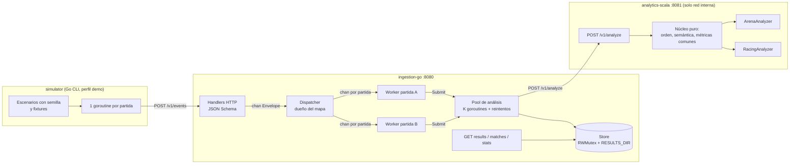
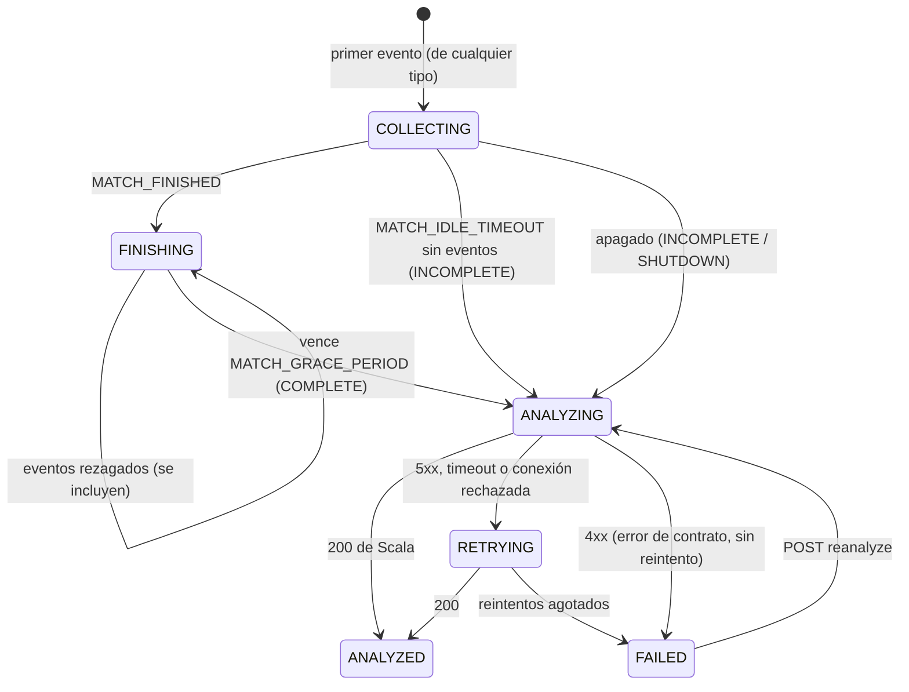

# Arquitectura

## 1. Visión general



| Componente | Paradigma | Responsabilidad | **No** hace |
|---|---|---|---|
| `simulator/` | — | Produce eventos de partidas y juegos en paralelo, incluidos casos especiales | Calcular estadísticas |
| `ingestion-go/` | Imperativo y concurrente | Recibe, valida, deduplica, agrupa por partida, controla el ciclo de vida, coordina el análisis, guarda y expone los resultados | **Calcular** métricas o patrones de juego |
| `analytics-scala/` | Funcional | Ordena, tipa, aplica reglas semánticas, calcula métricas y detecta patrones | Guardar estado, coordinar concurrencia, recibir eventos sueltos |
| `contracts/` | — | Fuente de verdad: esquemas, ejemplos, fixtures y resultados esperados | — |

Go guarda el resultado de Scala como bytes opacos (`json.RawMessage`). Los únicos conteos que hace Go son de diagnóstico de ingestión (`/v1/stats`), no de juego.

## 2. Concurrencia en Go

| Goroutine | Cantidad | Dueña de | Comunicación |
|---|---|---|---|
| Handler HTTP | 1 por petición (`net/http`) | nada | envía `Envelope` por `dispatcher.in` (buffer 1024) y espera la respuesta en `Reply` (buffer 1) |
| Dispatcher | **1** | `map[Key]chan Envelope` y las partidas cerradas (*tombstones*), **sin mutex** | reenvía al canal de la partida con **envío no bloqueante**; recibe avisos `Closed` |
| Worker de partida | **1 por partida activa** | eventos, hashes de duplicados, estado y temporizadores, **sin mutex** | `select` sobre su canal, el temporizador de gracia y el de inactividad |
| Pool de análisis | `ANALYZER_WORKERS` (4) | el trabajo en curso | consume su cola y llama a Scala |
| Store | — | única estructura compartida | `sync.RWMutex` |

**Por qué este diseño:**
- **Orden por partida.** Un solo goroutine procesa cada partida, así que no hay carreras sobre sus eventos.
- **Paralelismo real.** Las partidas avanzan en goroutines distintas, y el análisis (I/O lento) va en un pool aparte. La prueba `TestSlowAnalysisDoesNotBlockOtherMatches` demuestra que un análisis de 1.5 s no frena la ingestión de otra partida.
- **Backpressure sin bloqueo global.**
  - Si la cola de una partida está llena, ese evento recibe `503` y las demás partidas siguen.
  - Si el dispatcher está saturado, el handler responde `503` tras `INGEST_ENQUEUE_TIMEOUT`.
  - Reintentar es seguro porque el worker deduplica por `eventId`.
- **Cierre de canales.** Solo el emisor único (el dispatcher) cierra el canal de cada worker. Al apagar, el canal cerrado es la señal para que el worker vacíe su partida.
- **Verificación.** Todas las pruebas corren con `go test -race`. `TestConcurrentMatchesKeepTheirOwnEvents` usa 4 partidas con 4 productores concurrentes cada una.

## 3. Ciclo de vida de una partida



- Lo que llega después del envío se rechaza: `LATE_EVENT` si la partida terminó con `MATCH_FINISHED`, `MATCH_CLOSED` si expiró.
- Las partidas cerradas se recuerdan durante `TOMBSTONE_TTL` (1 h). Tras un reinicio, una partida ya analizada y recargada desde disco tampoco se reabre.

## 4. Núcleo funcional en Scala

```
RawEvent ──ordered──▶ ──decode(game)──▶ Either[Warning, Event[P]] ──semantics──▶ (kept, warnings)
         ──context──▶ MatchContext[P] ──game.playerMetrics / matchMetrics / patterns──▶ AnalysisResult
```

- `core/Analysis.scala`: el pipeline. Es una composición con `andThen`, y los errores van en un `Either` dentro de un for-comprehension.
- `core/GameAnalyzer.scala`: lo **único** que implementa un juego (`decode`, `check`, `playerMetrics`, `matchMetrics`, `patterns`).
- `games/arena`: `foldLeft` con un acumulador inmutable `Tally`, y `KillStreak` como `foldLeft` cuyo estado son las rachas abiertas.
- `games/racing`: `partition`, `groupMap`, `minOption`, y `COMEBACK` sobre la trayectoria de posiciones.
- No hay `var` ni colecciones mutables. El resultado es determinista: una prueba de propiedades verifica que 50 permutaciones de la llegada producen el mismo resultado.

## 5. Extensibilidad

Para agregar un juego hacen falta:
1. `contracts/schemas/games/<gameId>.v1.schema.json`. Go lo carga solo al arrancar.
2. `analytics-scala/.../games/<juego>/<Juego>Analyzer.scala`, que implementa `GameAnalyzer[P]`.
3. Una línea en `core/Registry.scala`.
4. Fixtures y resultados esperados.

Evidencia: el commit que agrega `street-racing` no modifica ningún archivo de `ingestion-go/` ni del núcleo de Scala, salvo esa línea del registro (ver `git show --stat` del commit `feat(racing)`). Antes, en un commit aparte, el núcleo pasó a conservar el `data` de `MATCH_STARTED` y `PLAYER_JOINED` para los atributos propios de cada juego.

## 6. Persistencia: qué se pierde al reiniciar

| Dato | Sin `RESULTS_DIR` | Con `RESULTS_DIR` (volumen, por defecto en Compose) |
|---|---|---|
| Resultados `ANALYZED` | Se pierden | **Se conservan** (`/data/<gameId>/<matchId>.json`, escritura atómica) |
| Partidas en curso (`COLLECTING`/`FINISHING`) | Al apagar ordenadamente se envían como `INCOMPLETE/SHUTDOWN`; ante un corte abrupto se pierden | Igual |
| Lotes `FAILED` (para `reanalyze`) | Se pierden | Se pierden (solo viven en memoria) |
| Tombstones | Se pierden | Las partidas recargadas siguen cerradas |
| Scala | Sin estado | Sin estado |

## 7. Configuración

Todas las variables están en [.env.example](../.env.example). Las más relevantes son `MATCH_GRACE_PERIOD`, `MATCH_IDLE_TIMEOUT`, `ANALYZE_TIMEOUT`, `ANALYZE_MAX_RETRIES`, `ANALYZE_BACKOFF_BASE`, `MAX_EVENTS_PER_MATCH`, `RESULTS_DIR` e `INGEST_API_KEY`.
